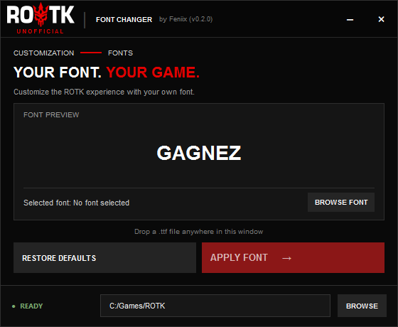

# ROTK Font Changer

**Customize your ROTK experience with your own font.**

ROTK Font Changer is a free Windows utility that lets you replace the default fonts in ROTK with your favorite TrueType font.

**Website:** https://rotkfontchanger.com

## Features

- Apply your own `.ttf` font to ROTK
- Preview fonts before applying them
- Drag and drop `.ttf` files
- Automatically detect the default ROTK installation
- Manually select your game installation folder
- Restore the original game fonts
- Lightweight Windows application built with C++ and Qt 6

## Community Font Compatibility

Not sure if a font works correctly in ROTK?

We're planning a community-driven font compatibility database where players will be able to:

- Discover fonts tested by other ROTK players.
- Check whether a font works, has issues, or is incompatible.
- Report their own compatibility results.
- Help other players find fonts that work well in-game.

**Coming soon:** A community font compatibility list on [rotkfontchanger.com](https://rotkfontchanger.com).

In the meantime, you can share your experiences through [GitHub Issues](https://github.com/benzwd/rotk-fonts-changer/issues).

## Download

Download the latest Windows version from [GitHub Releases](https://github.com/benzwd/rotk-fonts-changer/releases/latest).

No installer required.

## How to Use

1. Download `ROTKFontChanger.exe`.
2. Launch the application.
3. Check that your ROTK installation is detected.
4. Select or drag and drop a `.ttf` font.
5. Preview the font and click **APPLY FONT**.
6. Restart the game to see your new font.

To restore the original fonts, click **RESTORE DEFAULTS**.

## Important Notes

- Windows x64 only.
- The default installation path is `C:\Games\ROTK`.
- Font files are located in `UI/Resource/Fonts`.
- Applying a font replaces 19 game font files.
- Back up any customized game fonts before applying changes.

## Building from Source

The project uses C++20, CMake and Qt 6 Widgets.

The Windows CI builds the application using Visual Studio 2022 and vcpkg.

## Support the Project

If you enjoy ROTK Font Changer and want to support its development, you can buy me a coffee!

☕ [Buy Me a Coffee](https://buymeacoffee.com/zwdev)

Your support is appreciated, but completely optional.

## Disclaimer

ROTK Font Changer is an unofficial, community-made tool. It is not affiliated with or endorsed by the creators or publishers of ROTK.

## License

ROTK Font Changer's original source code is intended to be released under the MIT License. See the `LICENSE` file once added.

Third-party fonts and other assets are subject to their respective licenses.
